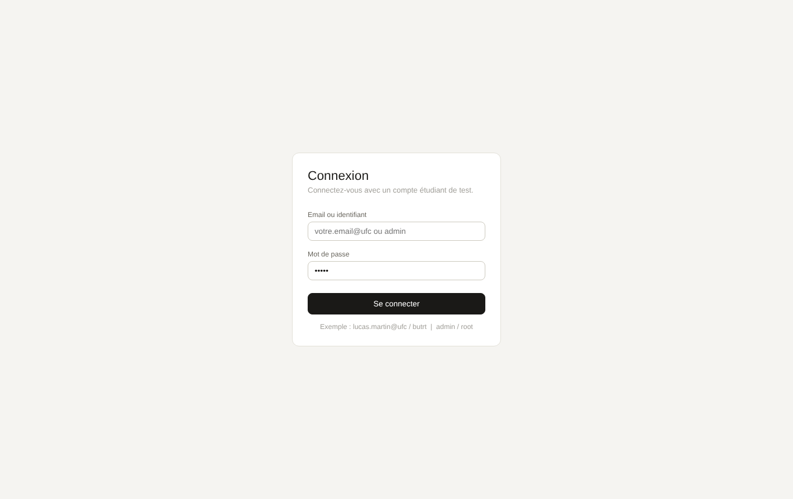
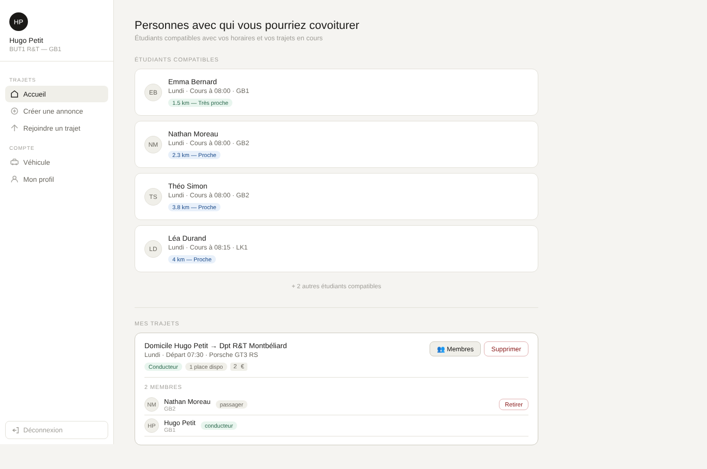
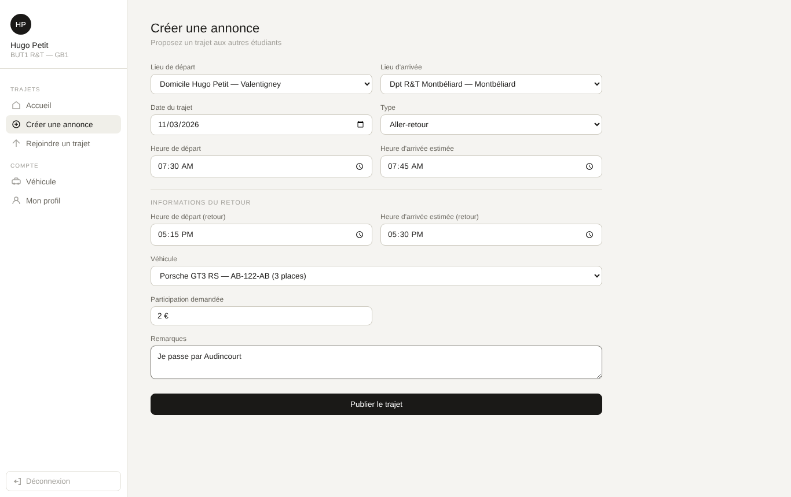
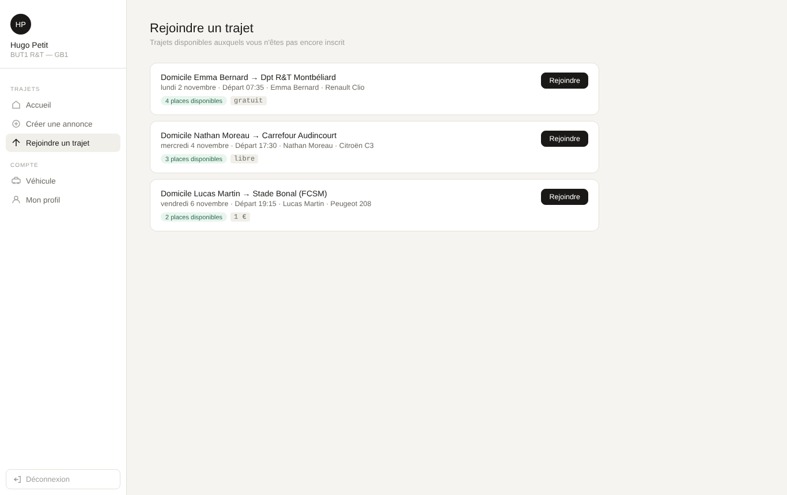
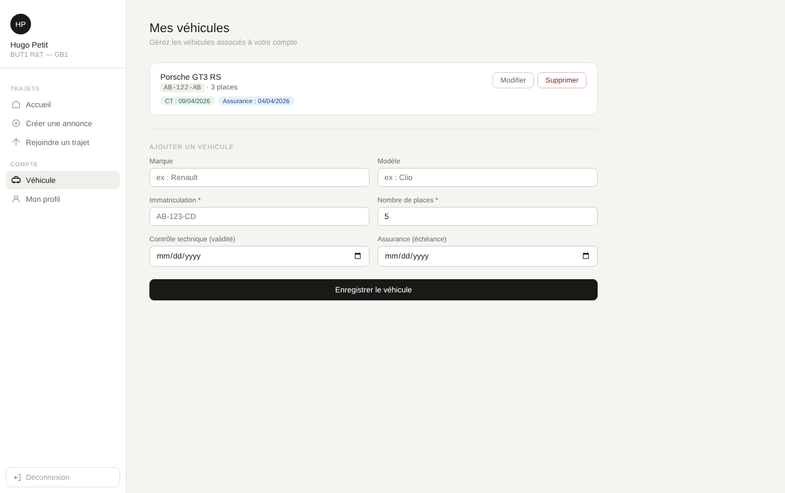
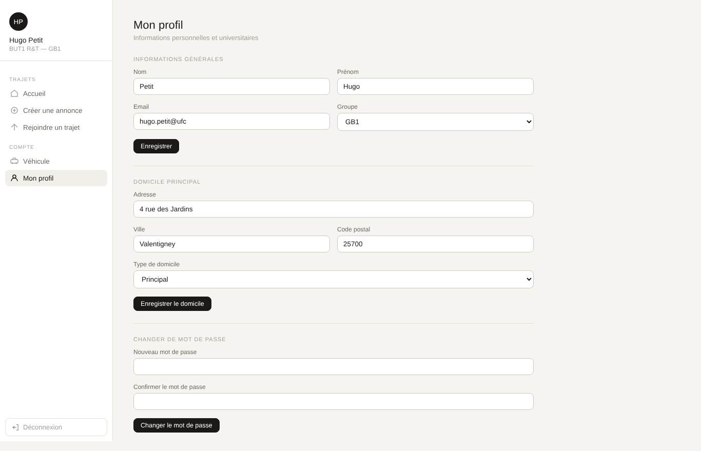
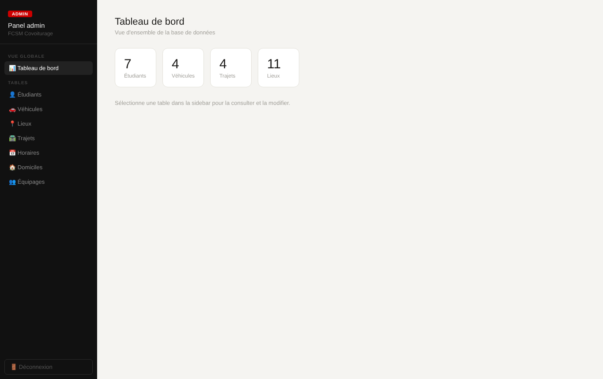
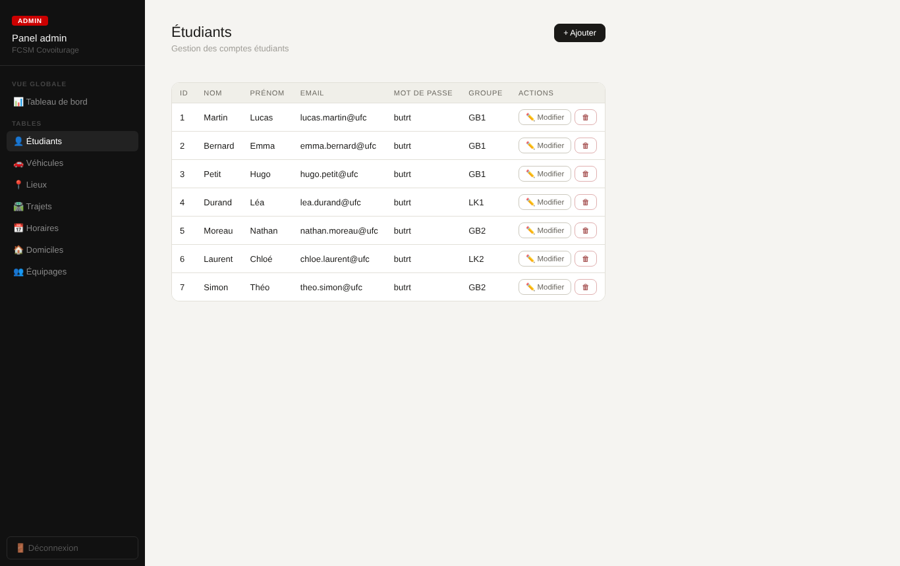
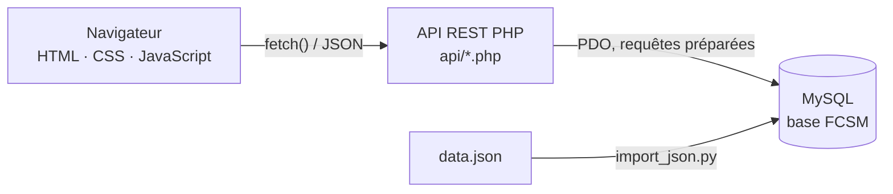
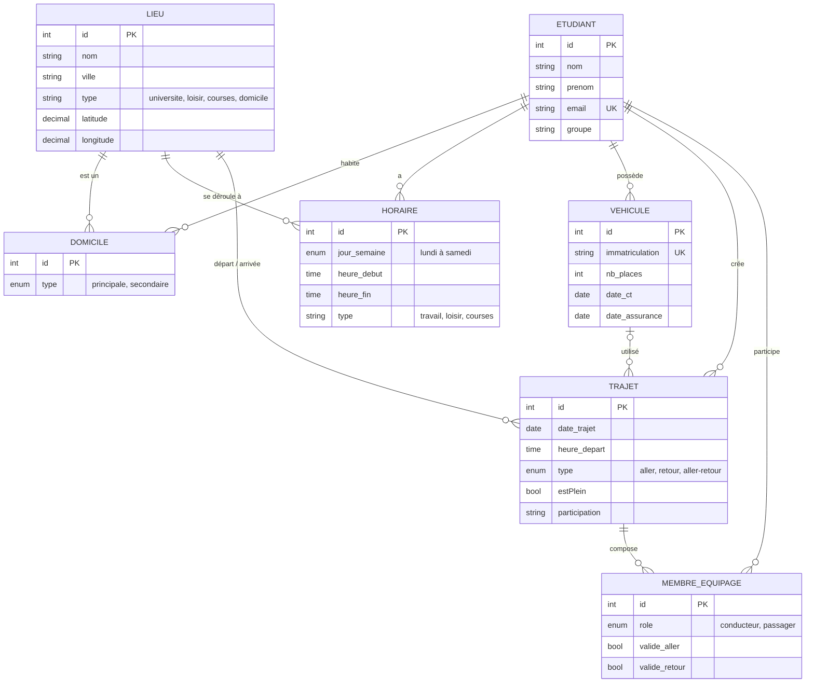

# Covoiturage étudiant — application web de mise en relation (SAÉ 23)

> Application web qui met en relation les étudiants du BUT R&T de Montbéliard ayant les mêmes horaires,
> pour organiser des trajets partagés vers l'IUT, les courses ou les matchs du FC Sochaux-Montbéliard.


**Contexte :** projet de 1ʳᵉ année de BUT Réseaux & Télécommunications (IUT Nord Franche-Comté, 2025-2026),
réalisé en binôme dans le cadre de la SAÉ 23 *« Mettre en place une solution informatique pour l'entreprise »*.
Une SAÉ est un projet en situation professionnelle : ici, un client fictif (le fan-club du FCSM) fournit un
[cahier des charges](docs/cahier-des-charges.md) et l'équipe doit livrer une application fonctionnelle, documentée et testée.

*English summary at the [end of this page](#english-summary).*

---

## Sommaire

- [Aperçu](#aperçu)
- [Fonctionnalités](#fonctionnalités)
- [Architecture](#architecture)
- [Base de données](#base-de-données)
- [Algorithme de mise en relation](#algorithme-de-mise-en-relation)
- [API](#api)
- [Installation](#installation)
- [Tests](#tests)
- [Structure du dépôt](#structure-du-dépôt)
- [Sécurité et limites](#sécurité-et-limites)
- [Documentation](#documentation)
- [English summary](#english-summary)

---

## Aperçu

|  |  |
|:---:|:---:|
| *Connexion* | *Accueil : étudiants compatibles triés par distance, mes trajets et mon équipage* |
|  |  |
| *Publier un trajet aller-retour* | *Trajets proposés par les autres, avec places restantes* |
|  |  |
| *Gestion des véhicules (CT, assurance)* | *Profil, domicile et mot de passe* |

**Interface d'administration**

|  |  |
|:---:|:---:|
| *Tableau de bord* | *Gestion des étudiants (ajout, modification, suppression)* |

> Les captures utilisent le jeu de données de démonstration (noms et adresses fictifs).

---

## Fonctionnalités

**Étudiant**
- Connexion par session PHP.
- **Mise en relation automatique** : liste des étudiants qui ont un créneau le même jour à ±15 minutes, triés par distance entre domiciles.
- **Trajets** : création (aller, retour ou aller-retour), date, horaires, véhicule, participation demandée, remarques.
- **Équipages** : rejoindre un trajet tant qu'il reste des places, le quitter ; le conducteur voit ses passagers et peut en retirer un. Un trajet passe automatiquement en « complet ».
- **Véhicules** : ajout, modification, suppression (marque, modèle, immatriculation, places, dates de contrôle technique et d'assurance).
- **Profil** : informations personnelles, domicile principal, mot de passe.

**Administrateur**
- Tableau de bord (nombre d'étudiants, véhicules, trajets, lieux).
- Ajout, modification et suppression dans les tables étudiants, véhicules, lieux, horaires et domiciles ; consultation et suppression des trajets et équipages.

**Données**
- Saisie possible **par fichier JSON** ([`database/data.json`](database/data.json)) importé avec un script Python, **ou** depuis l'interface web, comme demandé par le cahier des charges.

---

## Architecture



- **Front-end** : une seule page (SPA) en HTML/CSS/JavaScript sans framework. La navigation affiche ou masque des sections ; les données sont chargées avec `fetch()`.
- **Back-end** : une API PHP qui ne renvoie que du JSON, un fichier par ressource (`auth`, `matches`, `trajets`, `vehicules`, `profil`, `admin`).
- **Base de données** : MySQL, accès via PDO avec requêtes préparées (pas d'injection SQL possible par les paramètres).
- **Sessions PHP** : chaque endpoint vérifie l'utilisateur connecté et ses droits (conducteur, propriétaire du véhicule, admin).

---

## Base de données



Un **lieu** est générique : l'IUT, le stade Bonal, un supermarché ou le domicile d'un étudiant. Cela permet de calculer des distances entre n'importe quels points et de réutiliser la même table pour les trajets et les horaires.

---

## Algorithme de mise en relation

Implémenté dans [`app/api/matches.php`](app/api/matches.php) :

1. On récupère tous les créneaux (`horaire`) de l'étudiant connecté.
2. Pour chaque créneau, on cherche les autres étudiants ayant un créneau **le même jour** et dont l'heure de début diffère de **15 minutes au plus** :
   ```sql
   WHERE h.jour_semaine = ?
     AND ABS(TIME_TO_SEC(h.heure_debut) - TIME_TO_SEC(?)) <= 900
   ```
3. On calcule la **distance à vol d'oiseau** entre les deux domiciles avec la formule de **Haversine** (latitude et longitude en base).
4. On supprime les doublons (un étudiant compatible sur plusieurs créneaux n'apparaît qu'une fois) et on trie par distance croissante.

L'interface affiche les 4 plus proches avec un badge « Très proche » ou « Proche ».

---

## API

Toutes les réponses sont en JSON. Sauf `auth.php`, chaque endpoint exige une session (sinon `401`).

| Endpoint | Méthode | Rôle |
|---|---|---|
| `auth.php?action=me` | GET | utilisateur connecté |
| `auth.php` `{action: login \| logout}` | POST | connexion / déconnexion |
| `matches.php` | GET | étudiants compatibles, triés par distance |
| `trajets.php?type=mes \| disponibles` | GET | mes trajets / trajets non complets des autres |
| `trajets.php?type=membres&id_trajet=X` | GET | équipage (conducteur uniquement) |
| `trajets.php` `{action: create \| rejoindre \| quitter \| kick}` | POST | gestion des trajets et équipages |
| `trajets.php?id=X` | DELETE | supprimer son trajet |
| `vehicules.php` | GET · POST · PUT · DELETE | CRUD de ses véhicules |
| `profil.php?action=profil \| horaires \| lieux_trajet` | GET | profil, emploi du temps, lieux utilisables pour un trajet |
| `profil.php` `{action: update_profil \| update_mdp \| update_domicile}` | POST | mise à jour du profil |
| `admin.php?table=X` | GET · POST · PUT · DELETE | CRUD générique (admin, tables en liste blanche) |

Détail de chaque endpoint dans le [guide du développeur](docs/guide-developpeur.md).

---

## Installation

### Option 1 : Docker (le plus simple)

```bash
git clone https://github.com/spectral-phenix/covoiturage-etudiant-webapp-sae23.git
cd <nom-du-depot>
docker compose up -d
```

Puis ouvrir **http://localhost:8080**. La base est créée et remplie automatiquement au premier démarrage.

### Option 2 : WAMP / XAMPP / LAMP

1. Copier le dossier `app/` dans le dossier servi par Apache (ex. `C:/wamp64/www/covoiturage/`).
2. Dans phpMyAdmin, créer une base `FCSM` (interclassement `utf8mb4_unicode_ci`) puis importer [`database/fcsm.sql`](database/fcsm.sql).
3. Copier `app/api/config.example.php` en `app/api/config.php` et y mettre les identifiants MySQL.
4. Ouvrir `http://localhost/covoiturage/`.

### Option 3 : serveur PHP intégré (pour développer)

```bash
# base FCSM importée depuis database/fcsm.sql, puis :
cp app/api/config.example.php app/api/config.php   # adapter les identifiants
php -S localhost:8000 -t app
```

### Comptes de démonstration

| Rôle | Identifiant | Mot de passe |
|---|---|---|
| Étudiant | `hugo.petit@ufc` (ou tout autre étudiant de la base) | `butrt` |
| Administrateur | `admin` | `root` |

### Import depuis le fichier JSON (optionnel)

```bash
pip install mysql-connector-python
python database/import_json.py --vider     # remplace les données par celles de data.json
```

---

## Tests

Le cahier de tests est automatisé en deux parties :

- [`tests/test_api.py`](tests/test_api.py) — **26 scénarios sur l'API** (Python, bibliothèque standard uniquement). Il simule plusieurs étudiants et un administrateur, chacun avec sa session, et vérifie les fonctionnalités **et les droits d'accès** : authentification, mise en relation, véhicules, trajets, équipage complet, retrait d'un passager, administration.
- [`tests/test_interface.py`](tests/test_interface.py) — **15 scénarios dans un vrai navigateur** (Playwright) : le script clique dans l'application comme un utilisateur puis vérifie en base que l'action a été enregistrée.

```bash
python tests/test_api.py http://localhost:8080
```

```
T16  OK  Rejoindre un trajet complet (2 places)        refus 400
T17  OK  Retirer un passager sans être le conducteur   refus 403
T23  OK  Un étudiant appelle l'API d'administration    refus 403
...
26/26 tests réussis
```

Résultats détaillés et anomalies corrigées : [cahier de tests](docs/cahier-de-tests.md).

---

## Structure du dépôt

```
├── app/                      application web (dossier à servir)
│   ├── index.html            application étudiant (SPA)
│   ├── admin_panel.html      interface d'administration
│   ├── css/style.css
│   ├── js/app.js             logique front-end
│   └── api/                  API REST en PHP
│       ├── db.php            connexion PDO, session, fonctions communes
│       ├── config.example.php
│       ├── auth.php  matches.php  trajets.php  vehicules.php  profil.php  admin.php
├── database/
│   ├── fcsm.sql              structure + données de démonstration
│   ├── data.json             mêmes données au format JSON
│   └── import_json.py        import JSON → MySQL
├── tests/
│   ├── test_api.py           tests fonctionnels de l'API
│   └── test_interface.py     tests de l'interface dans un navigateur
├── docs/                     cahier des charges, guides, cahier de tests, captures
├── docker-compose.yml
└── Dockerfile
```

---

## Sécurité et limites

Ce projet est une **version pédagogique** ; plusieurs points seraient à reprendre avant une mise en production :

| Point | État actuel | Amélioration prévue |
|---|---|---|
| Mots de passe | stockés en clair | `password_hash()` / `password_verify()` |
| Compte admin | identifiants dans la configuration | table d'administrateurs avec mot de passe haché |
| Validation des entrées | côté client surtout | contrôles côté serveur (formats, ENUM, dates) |
| CORS | `*` | restreindre à l'origine réelle |
| Transport | HTTP | HTTPS |
| Intégrité | tables MyISAM sans clés étrangères | InnoDB + `FOREIGN KEY ... ON DELETE CASCADE` |
| Géolocalisation | coordonnées GPS du domicile saisies par l'admin (sans elles, pas de calcul de distance) | géocodage automatique de l'adresse (API Nominatim d'OpenStreetMap) |
| Emploi du temps | géré par l'admin, endpoint `profil.php?action=horaires` prêt mais pas encore affiché | affichage et saisie dans la page Profil |
| Validation des trajets | colonnes `valide_aller` / `valide_retour` en base | boutons de validation dans l'interface |

Ce qui est déjà en place : requêtes préparées partout, vérification côté serveur de l'auteur d'une action (seul le conducteur gère son équipage, seul le propriétaire modifie son véhicule), liste blanche des tables pour l'API d'administration, identifiants de base de données hors du code (`config.php` ignoré par git).

---

## Documentation

| Document | Public |
|---|---|
| [Cahier des charges](docs/cahier-des-charges.md) | contexte du projet |
| [Guide utilisateur](docs/guide-utilisateur.md) | étudiants |
| [User guide (English)](docs/user-guide.md) | English-speaking users |
| [Guide du développeur](docs/guide-developpeur.md) | reprise du code |
| [Cahier de tests](docs/cahier-de-tests.md) | validation |

---

## English summary

**Student carpooling web app.** Built in pairs during the first year of a networking & telecommunications degree (BUT R&T, France), for a fictional client: the supporters' club of the FC Sochaux-Montbéliard football team.

- Matches students whose schedules overlap (same day, start times within 15 minutes) and ranks them by home-to-home distance (Haversine formula).
- Lets students publish one-way or round trips, join or leave a crew, and manage their vehicles; drivers manage their passengers and trips switch to "full" automatically.
- Admin panel to add, edit and delete students, vehicles, places, timetables and homes, and to review trips and crews.
- Vanilla HTML/CSS/JavaScript single-page front-end, PHP REST API returning JSON, MySQL through PDO prepared statements.
- Data can be loaded from a JSON file (Python import script) or entered through the web interface.
- 41 automated tests (26 on the API, 15 in a real browser); Docker setup: `docker compose up -d`, then open http://localhost:8080 (demo login `hugo.petit@ufc` / `butrt`).

See the [English user guide](docs/user-guide.md).
